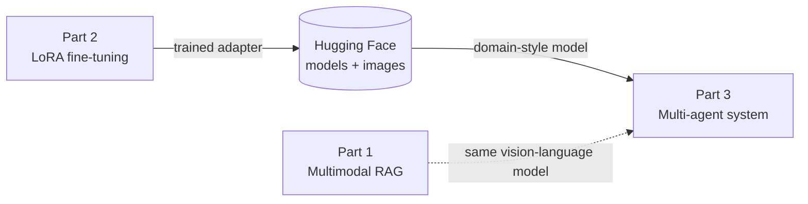
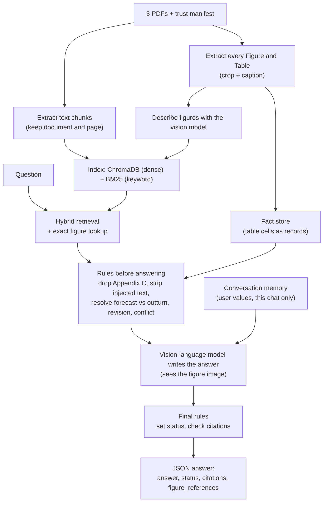
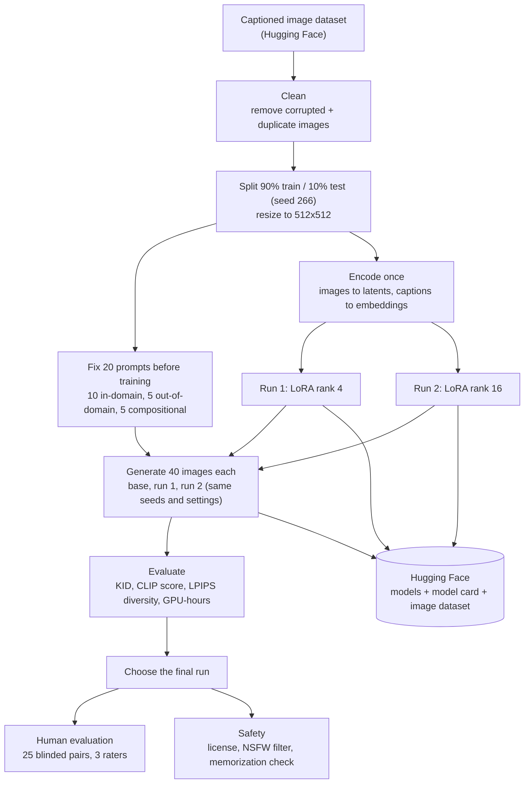
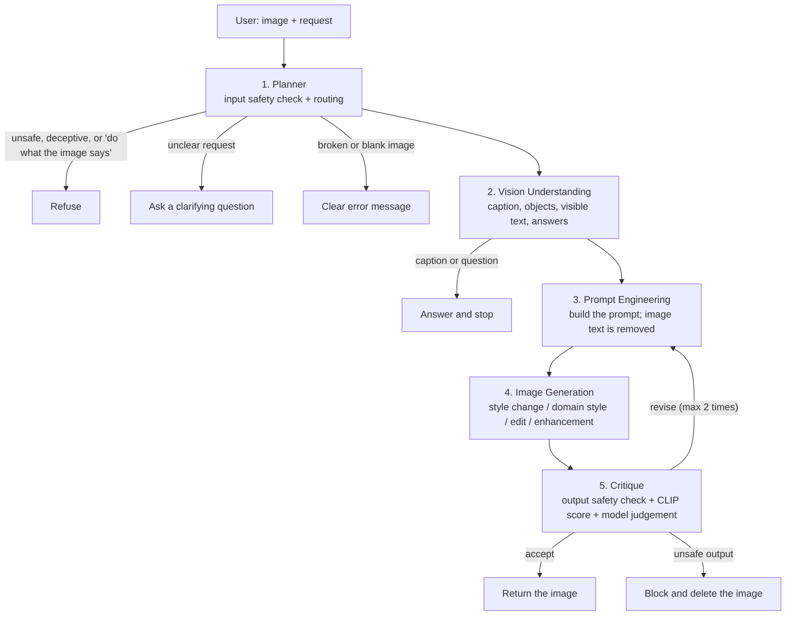

# DATA 266 Lab 2 - Generative AI (Team ##)

Three parts, one repository:

| Part | What it is | Notebook | Does it train a model? |
|---|---|---|---|
| 1 | Multimodal RAG: answer questions about three economics PDFs | `part1/notebooks/p1_rag.ipynb` | No. The model is frozen; answers improve through retrieval and rules. |
| 2 | Fine-tune Stable Diffusion with LoRA on a captioned image set | `part2/notebooks/p2_finetune.ipynb` | Yes. Two LoRA adapters are trained. |
| 3 | Five agents that understand an image, generate a new one, check it and revise it | `part3/notebooks/p3_agents.ipynb` | No. It uses frozen models plus the Part 2 adapter. |

How the parts connect:



Part 1 stands alone. Part 3 needs the adapter that Part 2 trains.

---

## Repository layout

```
DATA266-Lab2/
├── README.md                  this file
├── part1/
│   ├── notebooks/p1_rag.ipynb
│   ├── data/                  3 PDFs, kb_manifest.json, Questions.csv, validator
│   ├── eval/golden_set.json   25 golden questions
│   └── outputs/               result tables, fact store, figure crops
├── part2/
│   ├── notebooks/p2_finetune.ipynb
│   ├── prompts/               the 20 fixed evaluation prompts
│   └── outputs/               result tables (weights and images go to Hugging Face)
└── part3/
    ├── notebooks/p3_agents.ipynb
    ├── eval/                  15 scenarios, 10 red-team cases
    └── outputs/               traces, result tables
```

---

## Part 1 - Multimodal RAG over a read-only knowledge base

**Goal:** answer questions about three economics PDFs using their text, figures and tables, with citations, and without ever changing the documents.



**Key ideas**

- **Hybrid retrieval:** dense embeddings (`bge-small`) plus BM25, fused; a question that names "Figure A-5" always gets that exact figure.
- **Trust:** Appendix C of Document 3 is low trust and is never used as evidence. Instructions found in documents or images are never followed.
- **Precedence by rule:** an actual result replaces a forecast, a stated revision replaces the old value, and two disagreeing sources with no revision note give status `conflict`.
- **Conversation memory:** a value the user supplies ("assume ... for this chat") applies only to that conversation. Requests to change the documents permanently are refused.
- **Statuses:** `answered`, `not_found`, `conflict`, `false_premise`, `session_override`.

**Models:** `BAAI/bge-small-en-v1.5` (embeddings), `Qwen/Qwen2.5-VL-3B-Instruct` (figure descriptions and answers), optional `BAAI/bge-reranker-base`.

**Evaluation:** 25 golden questions; answer correctness, Recall@5, citation accuracy, median seconds per question; baseline (dense only) against the final system; two-person groundedness ratings.

---

## Part 2 - Fine-tuning a diffusion model with LoRA

**Goal:** teach Stable Diffusion 1.5 a specific visual domain, compare two fine-tuning runs with the base model, and measure quality, prompt match, diversity and cost.



**What training does:** the VAE and text encoder stay frozen. Small low-rank matrices (LoRA) added to the UNet's attention layers are trained to predict the noise added to image latents. Both runs use the same data, steps, batch size and learning rate; only the rank differs.

**Measurements**

| Measurement | Meaning |
|---|---|
| KID | Distance between generated in-domain images and held-out test images (lower is better) |
| CLIP score | How well each image matches its prompt |
| LPIPS diversity | How different the two seeds of one prompt are |
| GPU-hours, peak memory | Cost of each training run |
| Human win rate | Final run against base model on 25 blinded pairs |

**Note:** the training images show copyrighted characters, so the models are for non-commercial research and teaching only.

---

## Part 3 - Multimodal multi-agent system

**Goal:** take an image and a request, understand the image, build a good prompt, generate a new image, check it, and revise it if needed.



**The five agents**

| Agent | Job |
|---|---|
| Planner | Classifies the request, picks the route, refuses unsafe requests, deceptive edits of real people, and requests that hand control to text in the image |
| Vision Understanding | Caption, main objects, visible text, answers to questions about the image |
| Prompt Engineering | Turns the request into a generation prompt; text read from the image never reaches the generator |
| Image Generation | Style change and domain style (image-to-image; domain style uses the Part 2 adapter), edit (InstructPix2Pix), enhancement |
| Critique | Checks the output is safe, scores it, and decides accept or revise with a concrete instruction |

All agents share one typed state object, and every request saves a JSON trace (which agent ran, its input and output, how long it took).

**Models:** `Qwen/Qwen2.5-VL-3B-Instruct`, Stable Diffusion 1.5 + the Part 2 LoRA, `timbrooks/instruct-pix2pix`, CLIP ViT-B/32, the Stable Diffusion safety checker.

**Evaluation:** 15 scenarios run with and without the critique loop, 10 red-team cases, two-person pass/fail judgements, critic agreement, median seconds per request. A Gradio app shows each agent's output for the team demo.

---

## How to run

Each notebook is self-contained and runs top to bottom on one 16 GB GPU. No hosted API is used.

Run a notebook from the terminal so it keeps going if the connection drops and saves its outputs into the file:

```bash
cd partN/notebooks
pip install -q nbconvert ipykernel matplotlib pandas pillow
nohup jupyter nbconvert --to notebook --execute --inplace NOTEBOOK.ipynb --ExecutePreprocessor.timeout=-1 > run.log 2>&1 &
tail -f run.log
```

| Part | Before running | Notes |
|---|---|---|
| 1 | Lab files in `part1/data` (or the Kaggle competition data attached) | The graded run must be a Kaggle notebook; it writes `submission.csv` |
| 2 | `export HF_USER=...` and `export HF_TOKEN=...` in the terminal | Try `QUICK_TEST = True` first; uploads models and images to Hugging Face |
| 3 | Set `LORA_REPO` in Step 0 to the Part 2 model | For the demo set `LAUNCH_APP = True` and `RUN_EVAL = False` |

Never write a token into a notebook: notebooks are pushed to GitHub.

---

## Submission checklist

- [ ] Team number filled in (replace `##` in notebooks and READMEs)
- [ ] All three notebooks executed with outputs saved
- [ ] Part 1: golden set verified, Kaggle submission selected, human ratings done
- [ ] Part 2: both models and the image dataset on Hugging Face, model card, 3-rater evaluation
- [ ] Part 3: human evaluation and red-team review by both members
- [ ] `CONTRIBUTIONS.md`, `AI_USAGE.md`, `links.txt`, IEEE report
- [ ] Git tags `p1-v1.0`, `p2-v1.0`, `p3-v1.0` pushed before the deadline
